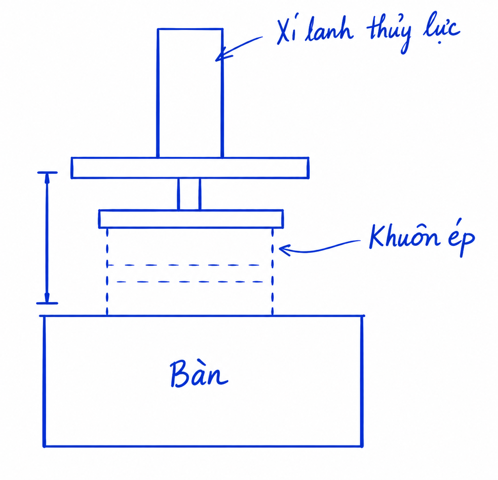
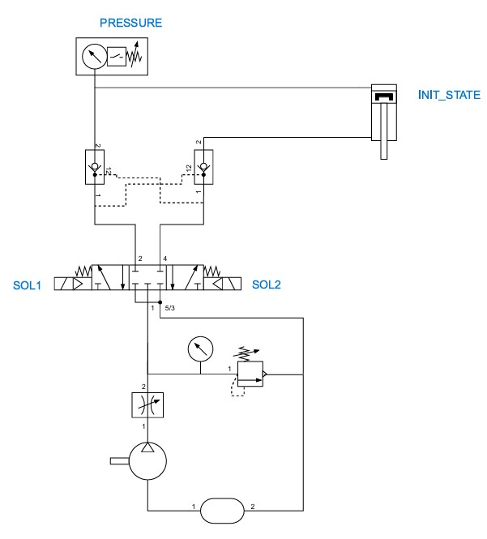
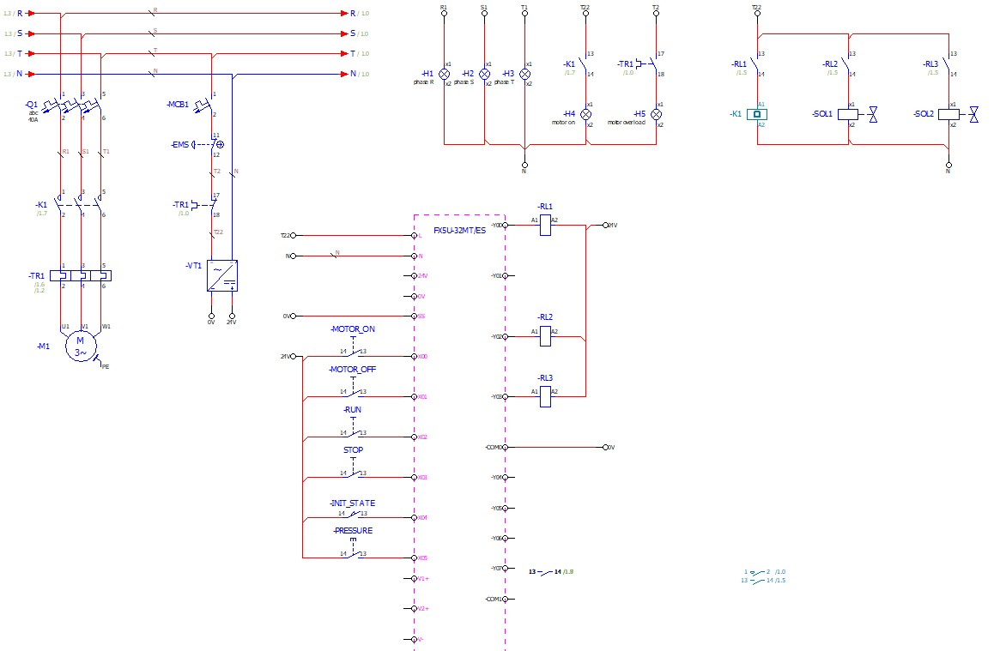
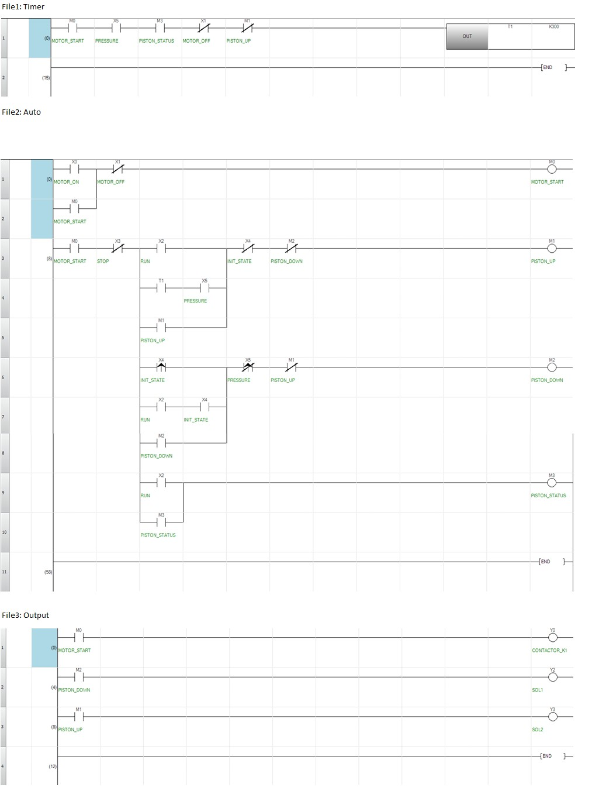
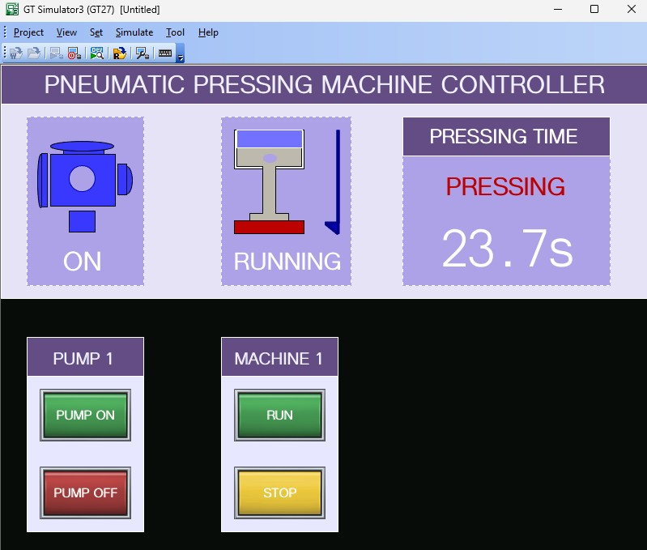

# Design a control system for Pressing Pneumatic system

This project is a PLC-based control system for a pneumatic valve mechanism using GxWork3 and GT designer 3

## 1. System objective

The system must perform the following sequence:

1. The pneumatic piston starts in the top position.
2. When the RUN signal is activated, the machine begins the automatic cycle.
3. The piston moves downward and applies pressure to the product.
4. The press cycle is maintained for 30 seconds while pressure is available.
5. After the timer expires, the piston moves back upward to the top position.

## 2. Pneumatic system

The pneumatic subsystem uses a double-solenoid valve 5/3 and a cylinder actuator to move the pistol up and down.

Description:

- INIT_STATE is limit switch at top position.
- PRESSURE is pressure switch confirms that sufficient compressed air is available before the press cycle continues.
- SOL1 is output signal that move the actuator downward for the pressing stroke.
- SOL2 is output signal that return the actuator upward to the top position.

## 3. Electric circuit

The electric circuit provides the control power and switching for the motor and the pneumatic solenoid valves.

Key electrical points:

- MOTOR_ON starts the motor drive.
- MOTOR_OFF stops the motor drive.
- RUN starts the automatic press cycle.
- STOP stop the pistol from moving.
- INIT_STATE confirms the piston is at the top position.
- PRESSURE confirm the sufficient compression.
- CONTACTOR_K1 start the motor.
- SOL1 drives the downward motion.
- SOL2 drives the upward motion.

## 4. Bill of materials (BOM)

Assume the problem involves a 3-phase, 4kW, 380V motor; choose the electrical equipment in accordance with the electrical design drawing.

For the given motor power, estimate the motor line current using the three-phase power formula:

`P = √3 × U × I × cos(φ) × η`, therefore `I = P / (√3 × U × cos(φ) × η)`.

Using `P = 4,000 W`, `U = 380 V`, motor `cos(φ) = 0.86`, and efficiency `η = 0.912`, the estimated motor line current is `I ≈ 7.75 A`. Use this motor current as a reference when selecting equipment ratings; determine each device's allowable current and protection settings according to its function, the motor nameplate, and applicable electrical standards.

Select the copper wire cross-sectional area using `S = I / J`. With estimated motor current `I = 7.75 A` and current density `J = 6 A/mm²`, `S = 7.75 / 6 ≈ 1.29 mm²`. Verify the selected wire size against installation conditions and applicable standards.

| No. | Equipment | Quantity | Model name | Allowable current | Specification / notes |
| --- | --- | ---: | --- | --- | --- |
| 1 | Contactor | 1 | Chint NXC-09 380V 9A 4kW | 9A | Three-pole, with at least one normally-open auxiliary contact |
| 2 | Intermediate relay | 3 | Schneider RXM2LB2P7 230VAC | x | Coil voltage and contact rating to suit the PLC interface and control circuit |
| 3 | Thermal overload relay | 1 | Chint NXR-25 | 7-10A | With two auxiliary contacts; set the trip current to the motor nameplate current |
| 4 | MCCB | 1 | LS ABS33c 10A 3P 14kA | 10A | Select the breaking capacity and current rating for the installation and motor circuit |
| 5 | MCB | 1 | Chint NCH8-25/20 25A 2NO 1P | 25A | Select the current rating for the control circuit |
| 6 | 24 VDC power supply | 1 | Schneider 24V 1.2A ABL8MEM24012 | x | 220 VAC input, 24 VDC output; for the PLC and compatible control devices |
| 7 | PLC | 1 | Mitsubishi FX5U-32MTT/ES 24VDC | x | 16 input, 16 output sink type |
| 8 | Green indicator lamp | 4 | AD16-22DS 220V Green | x | 220 V |
| 9 | Red indicator lamp | 1 | AD16-22DS 220V Red | x | 220 V |
| 10 | Emergency stop button | 1 | Schneider XA2ES642 | x | Latching type; normally-closed contact(s) suitable for the safety circuit |
| 11 | Wiring | 1  | Cadivi VCm/LF-1.5 mm2 | x | 220 V |

## 5. PLC program

### PLC tag definition

| Name | Tag | Description |
| --- | --- | --- |
| X0 | MOTOR_ON | Starting motor button |
| X1 | MOTOR_OFF | Stopping motor button |
| X2 | RUN | Run button |
| X3 | STOP | Stop button |
| X4 | INIT_STATE | Limit switch sensor |
| X5 | PRESSURE | Level pressure sensor |
| Y0 | CONTACTOR_K1 | Contactor for starting motor |
| Y2 | SOL1 | Actuator moving down signal of pistol |
| Y3 | SOL2 | Actuator moving up signal of pistol |

### Structure program

The ladder logic in the project is organized into three main programs:

- Timer: creates the 30-second timing block.
- Auto: handles the automatic sequence and state transitions.
- Output: maps internal control bits to real PLC output solenoid outputs.

### Ladder program:

## 6. HMI design example:

 

Note: the button maybe both physical button and interative component hmi
